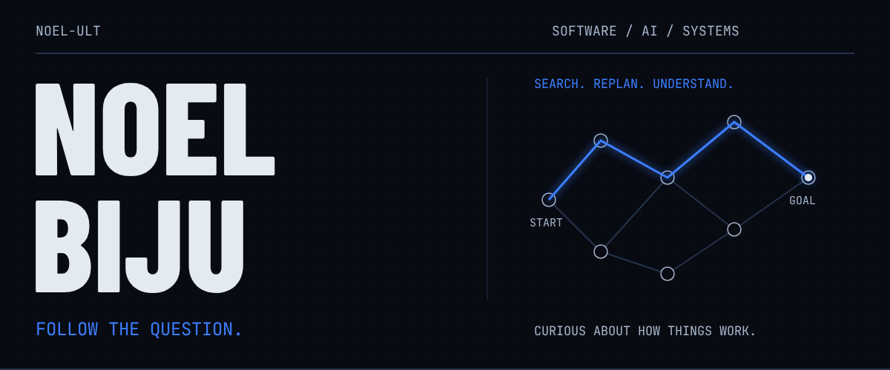
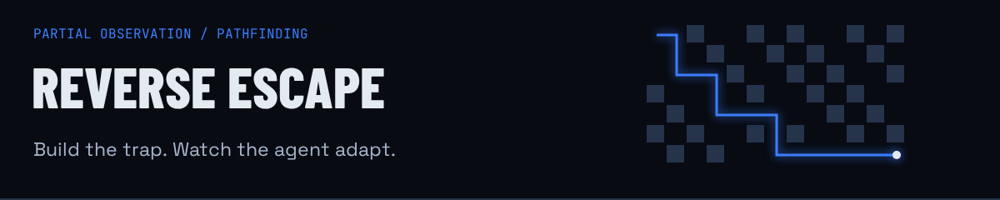
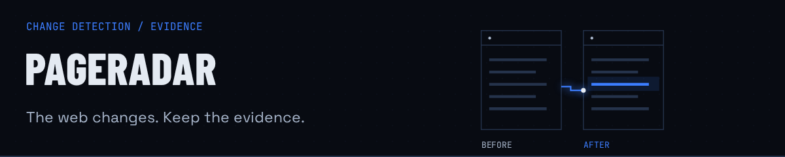
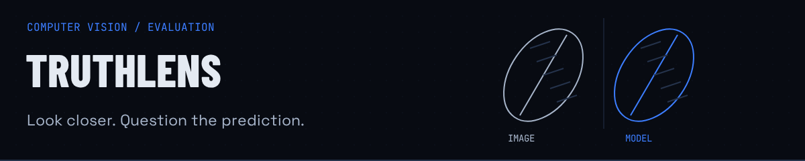
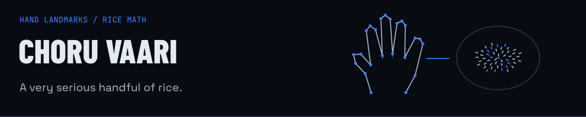

<picture>
  <source media="(prefers-reduced-motion: reduce)" srcset="./assets/systems-still.png" />
  <source srcset="./assets/systems.gif" type="image/gif" />
  
</picture>

[Pause the motion: view the still](./assets/systems-still.png)

# I'm Noel.

A computer science student from Kerala. I build web tools, experiment with local AI, and follow interesting questions into code. Sometimes that means a reliable background worker. Sometimes it means measuring rice in handfuls.

**B.Tech Computer Science · Sahrdaya · 2024–2028**

[Portfolio ↗](https://noelbiju.in) &nbsp; / &nbsp; [LinkedIn ↗](https://www.linkedin.com/in/noel-biju-788b81332) &nbsp; / &nbsp; [All repositories ↗](https://github.com/noel-ult?tab=repositories)

## What I'm building

**[Reverse Escape: Mind Wars](https://github.com/noel-ult/revescape)** — Design escape rooms for a scout that starts with partial knowledge. Frontier exploration and A* drive its search; discovered traps inform later attempts. Built for Devin Hacks Kochi 2026.

`Three.js` · `TypeScript` · `A* search` · `room validation`

**[PageRadar](https://github.com/noel-ult/PageRadar)** — A monitoring beta for the pages you keep checking manually. Detect meaningful changes, inspect before-and-after evidence, and follow checks through queues, retries, and alerts.

`Next.js` · `NestJS / GraphQL` · `PostgreSQL` · `BullMQ / Redis`

**[TruthLens](https://github.com/noel-ult/Truthlens)** — An experiment in distinguishing real and AI-generated images. A CLIP-based detector, comparison models, and an inspection app, with evaluation results and limitations documented alongside the code.

`Python` · `PyTorch / CLIP` · `scikit-learn` · `Streamlit`

**[Choru Vaari Kodukkam](https://github.com/noel-ult/chooru-varal)** — Estimate your rice-handful capacity from hand landmarks, then count the vaaris on a plate. I worked on hand tracking, vaari estimation, and the frontend; Samuel Thomas C contributed rice-image analysis, UI, and testing. Built at TinkerHub Useless Projects.

`TypeScript` · `Next.js` · `MediaPipe` · `Canvas`

### Local AI & systems experiments

**[AI Buddy](https://github.com/noel-ult/AI_BUDDY)** — A terminal assistant with local Ollama inference, SQLite memory, and reminders. Exploring how useful an assistant can be with the model running locally.

**[Flexy](https://github.com/noel-ult/Flexy)** — A narrowly supported package-conversion experiment: inspect a Linux `.deb` and build an Arch package when an exact supported recipe matches.

## How I build

**Foundations** &nbsp; C / C++ · Python · TypeScript · SQL · algorithms · databases

**Web systems** &nbsp; React / Next.js · FastAPI · NestJS / GraphQL · PostgreSQL · Redis

**AI & tooling** &nbsp; PyTorch · CLIP · Ollama · Git · Docker · Linux

I like tracing a system from input to output, finding where the assumptions break, and building enough of it to understand the tradeoffs. Local models, observable agents, and dependable background jobs keep pulling me back.

---

Building something unusual, experimenting with local AI, or untangling a system? [Let's talk.](https://www.linkedin.com/in/noel-biju-788b81332)

<!-- documentation-navigation -->
[Developer guide](docs/PROJECT_GUIDE.md) · [Source reference](docs/REFERENCE.md) · [Contributing](CONTRIBUTING.md)
<!-- /documentation-navigation -->

<!-- developer-handbook-20261028 -->
[Developer guide](docs/PROJECT_GUIDE.md) · [Source reference](docs/REFERENCE.md) · [Verification and operations](docs/OPERATIONS.md)
<!-- /developer-handbook-20261028 -->
