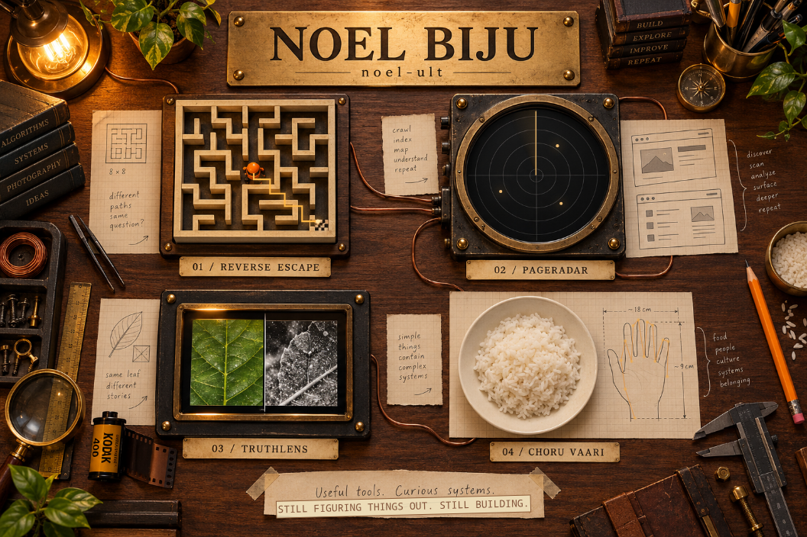

<picture>
  <source media="(prefers-reduced-motion: reduce)" srcset="./assets/workbench-still.png" />
  <source srcset="./assets/workbench.gif" type="image/gif" />
  
</picture>

[View the still workbench](./assets/workbench-still.png)

# Hey, I'm Noel.

I build web tools, explore AI systems, and occasionally turn a ridiculous idea into working software. This is my bench: a few useful things, a few experiments, and plenty left to figure out.

[Portfolio ↗](https://noelbiju.in) · [LinkedIn ↗](https://www.linkedin.com/in/noel-biju-788b81332)

## Four things on the bench

### 01 · [Reverse Escape: Mind Wars](https://github.com/noel-ult/revescape)

You build the trap. The agent tries to find its way out. A 3D escape-room game with a scout that explores under partial observation, plans with A*, and remembers discovered traps. Built for Devin Hacks Kochi 2026.

**Inside:** Three.js · frontier exploration · A* · server-side room validation

### 02 · [PageRadar](https://github.com/noel-ult/PageRadar)

For the webpages you keep checking manually. A monitoring beta that detects meaningful changes and shows the before-and-after evidence, backed by durable checks, retries, and alerts.

**Inside:** Next.js · NestJS / GraphQL · PostgreSQL · BullMQ / Redis

### 03 · [TruthLens](https://github.com/noel-ult/Truthlens)

An experiment in telling real and AI-generated images apart. A CLIP-based detector, comparison models, and a Streamlit inspection app—with evaluation results and limitations documented in the repo.

**Inside:** Python · PyTorch · CLIP · scikit-learn · Streamlit

### 04 · [Choru Vaari Kodukkam](https://github.com/noel-ult/chooru-varal)

How many handfuls of rice are on that plate? Hand landmarks estimate your vaari capacity; image segmentation estimates the choru. A suspiciously serious answer to a wonderfully unnecessary question. Built with Samuel Thomas C.

**Inside:** TypeScript · Next.js · MediaPipe · Canvas · TinkerHub Useless Projects

## On the bench lately

Agents whose decisions you can inspect, web systems that survive failed jobs, and computer vision experiments that make me question the dataset before trusting the result.

**Tools within reach:** TypeScript, Python, React / Next.js, FastAPI / NestJS, PostgreSQL, Docker, and Linux.

---

Got an interesting build, a strange idea, or a better way to solve one of these? [Let's compare notes.](https://www.linkedin.com/in/noel-biju-788b81332)

<!-- documentation-navigation -->
[Developer guide](docs/PROJECT_GUIDE.md) · [Source reference](docs/REFERENCE.md) · [Contributing](CONTRIBUTING.md)
<!-- /documentation-navigation -->
